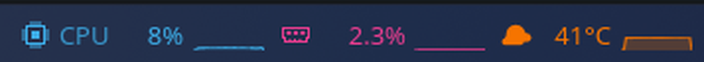
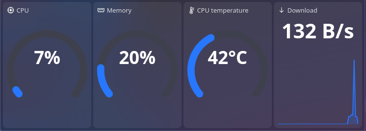
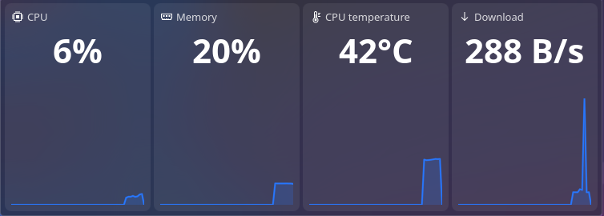
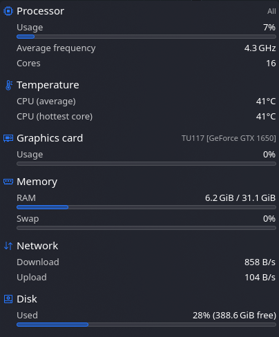

# Pulso

A Vitals-style system monitor for **KDE Plasma 6**: icon + value for CPU, RAM, temperatures,
network, disk, GPU, fans… or any other sensor your machine exposes, in the panel or as cards on the desktop.


*[Português abaixo](#português)*

| Panel, customized | Desktop cards |
| --- | --- |
|  |  |

## Features

- **Any sensor.** Pick from every sensor KDE knows about (the same list as System Monitor), in any order.
- **Make each one yours**: label, icon (automatic, any icon from your theme, or your own SVG/PNG), color, decimals and what a click does.
- **Your font and spacing**: family, size, bold, icon size, space between items.
- **History line** next to each value in the panel, if you like graphs.
- **Desktop cards** with a gauge, a history graph or a big number. Use Plasma's own background options (standard, translucent, none).
- **Warning colors**: values turn orange/red above configurable limits for percentages and temperatures.
- **Alerts**: a notification when something stays critical for a while.
- **Details popup** with processor, temperatures, graphics card, memory, network, disk, uptime and the processes using the most CPU (end one with two clicks).
- **Presets** (Default, Colorful, Text labels, Graphs, Compact) and **backup/share** of your whole setup as JSON.
- **Smart hiding**: sensors that don't exist on the machine, or temperatures stuck at 0 (e.g. NVIDIA on `nouveau`), are hidden.
- **Horizontal and vertical panels.**
- **Lightweight and safe**: reads everything through KDE's `ksystemstats` service. No network access, no scripts polling in the background, and clicks only ever launch a fixed list of programs.
- English and Brazilian Portuguese.

<details>
<summary>More screenshots</summary>





</details>

## Install

**From the KDE Store** *(coming soon)*: right-click the panel → *Add Widgets…* → *Get New Widgets…* → search for **Pulso**.

**From a release**: download the `.plasmoid` file from [Releases](https://github.com/rempel/pulso/releases), then:

```bash
kpackagetool6 -t Plasma/Applet -i pulso-*.plasmoid
```

**From source**:

```bash
git clone https://github.com/rempel/pulso.git
cd pulso
./scripts/install.sh
systemctl --user restart plasma-plasmashell
```

Then right-click the panel (or the desktop) → *Add Widgets…* and drag **Pulso** onto it.

Requirements: Plasma 6.0+ with `ksystemstats` (installed by default on Plasma desktops). For CPU temperatures you may need `lm-sensors`.

## Configure

Right-click the widget → *Configure Pulso…*

| Page | What's there |
| --- | --- |
| General | Sensors, what a click does, colors on/off, hide unavailable, update interval, limits |
| Sensors | Per sensor: label, icon, color, decimals, click action |
| Appearance | Icons, font, spacing, history line in the panel |
| Desktop | Card style (gauge, graph, big number), columns, history length, card background |
| Alerts & popup | Critical alerts with duration and cooldown; top processes in the popup |
| Presets | Ready-made looks; export/import the whole setup as JSON |

## Development

```
package/            the plasmoid (metadata.json + contents/)
  contents/ui/      main.qml, Metric.qml (panel item), Card.qml + DesktopView.qml (desktop),
                    PopupView.qml + ProcessList.qml (popup), MetricModel.qml (shared sensor logic),
                    AlertWatcher.qml, config*.qml (settings pages), logic.js (pure helpers)
  contents/icons/   bundled SVG icons (pulso-*.svg, monochrome, recolored at runtime)
po/                 translations
scripts/            build.sh, install.sh, extract-messages.sh, msgfmt.py
```

- `./scripts/install.sh` builds translations and installs/upgrades the widget for your user.
- `./scripts/build.sh` produces `dist/pulso-<version>.plasmoid`.
- Pushing a `v*` tag builds the `.plasmoid` and attaches it to a GitHub release.

Icons are named `pulso-*.svg` on purpose: a plain name like `cpu.svg` can be overridden by an icon theme that ships an icon with the same name.

### Translating

Copy `po/pt_BR.po` to `po/<lang>.po`, translate the `msgstr` lines and open a pull request.
Maintainers can refresh the template with `./scripts/extract-messages.sh` (needs `gettext`).

See [ROADMAP.md](ROADMAP.md) for what's done and what's next.

## License

GPL-3.0-or-later. See [LICENSE](LICENSE).

---

## Português

Monitor de sistema no estilo Vitals para o **KDE Plasma 6**: ícone + valor para CPU, RAM, temperaturas,
rede, disco, GPU, ventoinhas… ou qualquer outro sensor do seu PC, na barra ou em cards na área de trabalho.

- **Qualquer sensor**, escolhido na mesma lista do Monitor do Sistema, na ordem que você quiser.
- **Do seu jeito**: rótulo, ícone (automático, do tema ou um SVG/PNG seu), cor, casas decimais e ação ao clicar, para cada sensor.
- **Fonte e espaçamento** à sua escolha, e **mini-gráfico de histórico** na barra.
- **Cards na área de trabalho** com medidor, gráfico de histórico ou número grande.
- **Cores de alerta** e **notificações** quando algo fica crítico por um tempo.
- **Popup de detalhes** com processador, temperaturas, placa de vídeo, memória, rede, disco e os processos que mais usam CPU.
- **Predefinições** e **backup/compartilhamento** da configuração em JSON.
- **Leve e seguro**: lê tudo pelo `ksystemstats` do KDE, sem acesso à internet; cliques só abrem uma lista fixa de programas.

Instalação a partir do código:

```bash
git clone https://github.com/rempel/pulso.git
cd pulso
./scripts/install.sh
systemctl --user restart plasma-plasmashell
```

Depois clique com o botão direito na barra (ou na área de trabalho) → *Adicionar widgets…* e arraste o **Pulso**.
