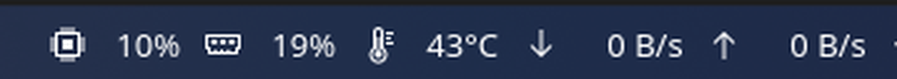

# Pulso

A Vitals-style system monitor for the **KDE Plasma 6** panel: icon + value for CPU, RAM,
temperatures, network, disk, GPU, fans… or any other sensor your machine exposes.



*[Português abaixo](#português)*

## Features

- **Any sensor.** Pick from every sensor KDE knows about (the same list as System Monitor), in any order.
- **Clean monochrome icons** that follow your color scheme, chosen automatically from the sensor type.
- **Warning colors**: values turn orange/red above configurable limits for percentages and temperatures.
- **Smart hiding**: sensors that don't exist on the machine, or temperatures stuck at 0 (e.g. NVIDIA on `nouveau`), are hidden.
- **Steady panel**: tabular digits and reserved width, so the panel doesn't jump as numbers change.
- **Details popup** with processor, temperatures, graphics card, memory, network, disk and uptime.
- **Horizontal and vertical panels.**
- **Lightweight and safe**: reads everything through KDE's `ksystemstats` service. No network access, no shell scripts polling in the background.
- English and Brazilian Portuguese.

## Install

**From the KDE Store** *(coming soon)*: right-click the panel → *Add Widgets…* → *Get New Widgets…* → search for **Pulso**.

**From a release**: download the `.plasmoid` file from [Releases](https://github.com/rempel/pulso/releases), then:

```bash
kpackagetool6 -t Plasma/Applet -i pulso-*.plasmoid
```

**From source**:

```bash
git clone https://github.com/rempel/pulso.git
cd pulso
./scripts/install.sh
systemctl --user restart plasma-plasmashell
```

Then right-click the panel → *Add Widgets…* and drag **Pulso** onto it.

Requirements: Plasma 6.0+ with `ksystemstats` (installed by default on Plasma desktops). For CPU temperatures you may need `lm-sensors`.

## Configure

Right-click the widget → *Configure Pulso…*

| Option | Default |
| --- | --- |
| Sensors in the panel | CPU usage, RAM usage, CPU temperature |
| Show icons | on |
| Change color above the limits | on |
| Hide unavailable sensors | on |
| Update interval | 2000 ms |
| Percentages warning / critical | 75 % / 90 % |
| Temperatures warning / critical | 70 °C / 85 °C |

## Development

```
package/            the plasmoid (metadata.json + contents/)
  contents/ui/      QML: main.qml (panel + popup), Metric.qml (one panel item), configGeneral.qml
  contents/icons/   bundled SVG icons (pulso-*.svg, monochrome, recolored at runtime)
po/                 translations
scripts/            build.sh, install.sh, extract-messages.sh, msgfmt.py
```

- `./scripts/install.sh` builds translations and installs/upgrades the widget for your user.
- `./scripts/build.sh` produces `dist/pulso-<version>.plasmoid`.
- Pushing a `v*` tag builds the `.plasmoid` and attaches it to a GitHub release.

Icons are named `pulso-*.svg` on purpose: a plain name like `cpu.svg` can be overridden by an icon theme that ships an icon with the same name.

### Translating

Copy `po/pt_BR.po` to `po/<lang>.po`, translate the `msgstr` lines and open a pull request.
Maintainers can refresh the template with `./scripts/extract-messages.sh` (needs `gettext`).

## License

GPL-3.0-or-later. See [LICENSE](LICENSE).

---

## Português

Monitor de sistema no estilo Vitals para a barra do **KDE Plasma 6**: ícone + valor para CPU, RAM,
temperaturas, rede, disco, GPU, ventoinhas… ou qualquer outro sensor que o seu PC tenha.

- **Qualquer sensor**, escolhido na mesma lista do Monitor do Sistema, na ordem que você quiser.
- **Ícones monocromáticos** que seguem as cores do tema, escolhidos automaticamente pelo tipo de sensor.
- **Cores de alerta** (laranja/vermelho) acima de limites configuráveis.
- **Esconde sozinho** sensores que não existem ou temperaturas travadas em 0.
- **Popup de detalhes** com processador, temperaturas, placa de vídeo, memória, rede, disco e tempo ligado.
- **Leve e seguro**: lê tudo pelo serviço `ksystemstats` do KDE. Sem acesso à internet, sem scripts rodando em segundo plano.

Instalação a partir do código:

```bash
git clone https://github.com/rempel/pulso.git
cd pulso
./scripts/install.sh
systemctl --user restart plasma-plasmashell
```

Depois clique com o botão direito na barra → *Adicionar widgets…* e arraste o **Pulso** para ela.
