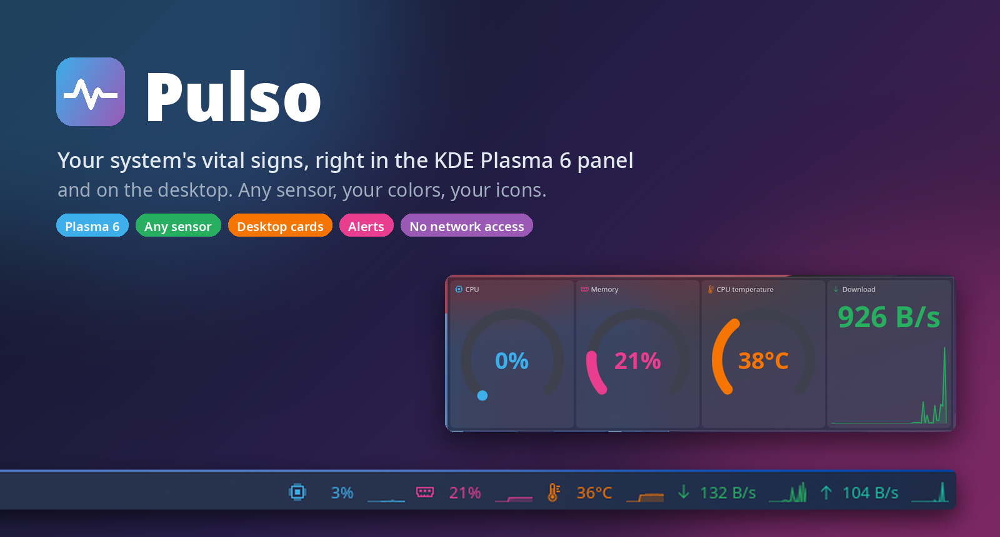
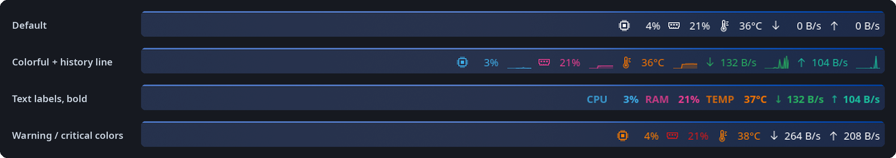
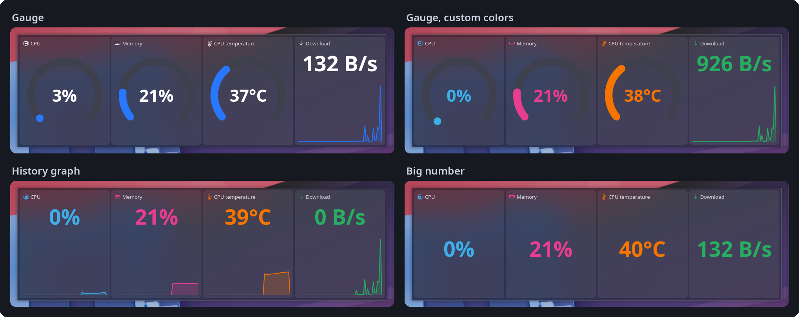
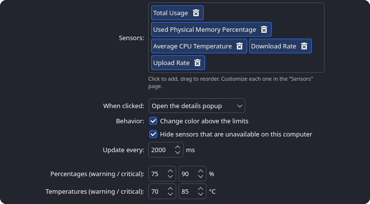
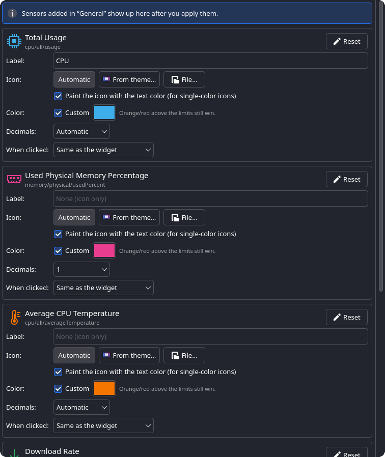
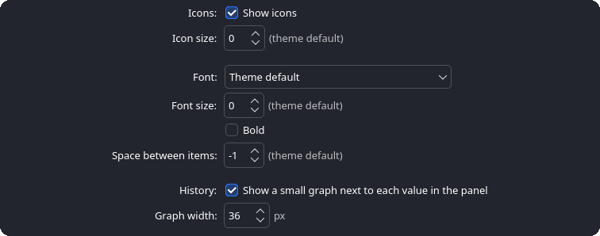
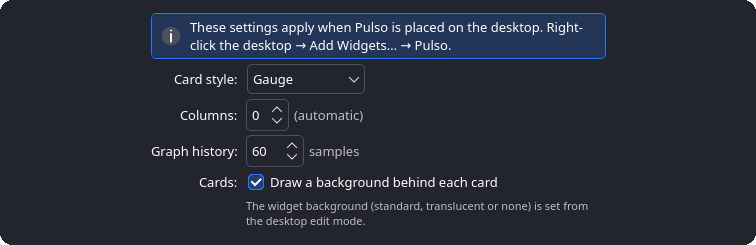
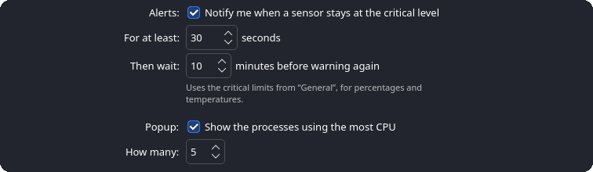
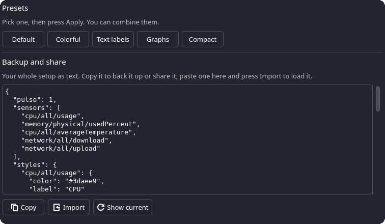

<p align="center">
  
</p>

<p align="center">
  <a href="https://github.com/rempel/pulso/releases/latest"></a>
  <a href="https://github.com/rempel/pulso/actions/workflows/build.yml"></a>
  
  
  <a href="LICENSE"></a>
</p>

<p align="center">
  <b>Your computer's vital signs, at a glance.</b><br>
  CPU, memory, temperatures, network, disk, GPU, fans — or <i>any</i> sensor KDE can read —<br>
  in the panel, on the desktop, and one click away in a detailed popup.
</p>

<p align="center">
  <a href="#-features">Features</a> ·
  <a href="#-a-tour">Tour</a> ·
  <a href="#-install">Install</a> ·
  <a href="#%EF%B8%8F-settings">Settings</a> ·
  <a href="#-recipes">Recipes</a> ·
  <a href="#-faq">FAQ</a> ·
  <a href="ROADMAP.md">Roadmap</a> ·
  <a href="#-português">Português</a>
</p>

---

## ✨ Features

<table>
  <tr>
    <td width="33%" valign="top">
      <h3>🎯 Any sensor</h3>
      Everything KDE's System Monitor knows about — total or per-core CPU, memory, swap, every temperature,
      fans, GPU, network, disks, battery — picked from a searchable list and reordered by drag.
    </td>
    <td width="33%" valign="top">
      <h3>🎨 Truly yours</h3>
      Per sensor: <b>label</b>, <b>icon</b> (automatic, any icon from your theme, or your own SVG/PNG),
      <b>color</b>, <b>decimals</b> and <b>what a click does</b>. Plus font, size, weight and spacing.
    </td>
    <td width="33%" valign="top">
      <h3>🖥️ Panel <i>and</i> desktop</h3>
      A slim, steady strip in the panel (horizontal or vertical), or cards on the desktop with
      <b>gauges</b>, <b>history graphs</b> or <b>big numbers</b>.
    </td>
  </tr>
  <tr>
    <td valign="top">
      <h3>🚦 Know when it matters</h3>
      Values turn <b>orange</b> and <b>red</b> above your limits, and an optional
      <b>notification</b> fires when something stays critical — with a cooldown so it never nags.
    </td>
    <td valign="top">
      <h3>🔍 Details on click</h3>
      A popup with processor, temperatures, graphics card, memory, network, disk, uptime and the
      <b>processes using the most CPU</b> — end one with two clicks.
    </td>
    <td valign="top">
      <h3>🔒 Light and private</h3>
      Reads through KDE's own <code>ksystemstats</code> service. <b>No network access</b>, no scripts
      polling in the background, and clicks only launch a fixed list of programs.
    </td>
  </tr>
</table>

Also: **presets** to switch looks in one click, **export/import** of your whole setup as JSON,
**smart hiding** of sensors your machine doesn't have, a **history line** next to each value in the panel,
and translations (English, Português do Brasil — yours welcome).

## 📸 A tour

### In the panel

Clean by default; as colorful, labeled or graph-y as you like. The width is reserved for the widest
possible value, so your panel never jumps around as numbers change.

<p align="center"></p>

### On the desktop

Drop Pulso on the desktop and it becomes a set of cards. Pick a style, a number of columns (or let it adapt
to the size), and Plasma's own background option — standard, translucent or none. Sensors without a known
maximum, like network speed, automatically get a graph instead of a gauge.

<p align="center"></p>

### One click away

<table>
  <tr>
    <td width="42%"></td>
    <td valign="top">
      <p>Click the panel item (or pick another action) to open a full overview:</p>
      <ul>
        <li><b>Processor</b> — usage, average frequency, cores</li>
        <li><b>Temperature</b> — average and hottest core</li>
        <li><b>Graphics card</b> — usage, temperature and video memory, when the driver reports them</li>
        <li><b>Memory</b> — RAM and swap with bars</li>
        <li><b>Network</b> — download and upload</li>
        <li><b>Disk</b> — used space</li>
        <li><b>Top processes</b> — by CPU, as a share of the whole machine, with memory, and a two-click
            <i>end process</i> button</li>
        <li><b>Uptime</b> and a shortcut to KDE's System Monitor</li>
      </ul>
      <p>Each sensor in the panel can also have its own click action:
      <b>open this popup</b>, <b>open System Monitor</b>, <b>open a terminal with htop</b>, or <b>nothing</b>.</p>
    </td>
  </tr>
</table>

## 📦 Install

**From a release** — download `pulso-<version>.plasmoid` from [Releases](https://github.com/rempel/pulso/releases/latest), then:

```bash
kpackagetool6 -t Plasma/Applet -i pulso-*.plasmoid
```

**From source:**

```bash
git clone https://github.com/rempel/pulso.git
cd pulso
./scripts/install.sh
systemctl --user restart plasma-plasmashell
```

**From the KDE Store** — *coming soon*: right-click the panel → *Add Widgets…* → *Get New Widgets…* → search for **Pulso**.

Then right-click the **panel** or the **desktop** → *Add Widgets…* and drag **Pulso** onto it.

> **Requirements:** KDE Plasma 6.0+ with `ksystemstats` (installed by default on Plasma desktops).
> For CPU temperatures you may need `lm-sensors` (`sudo sensors-detect` once).

To update, install the new `.plasmoid` with `-u` instead of `-i`, or run `./scripts/install.sh` again.

## ⚙️ Settings

Right-click Pulso → **Configure Pulso…** Six pages, everything optional — the defaults just work.

### General — what to show

Pick sensors from KDE's own searchable list and drag to reorder. Choose what a click does, turn the
warning colors on or off, hide sensors your machine doesn't have, and set the update rate and limits.

<p align="center"></p>

### Sensors — make each one yours

Every sensor gets its own card: a **label** (“CPU”, “GPU”, or nothing), an **icon** — automatic, picked from
your icon theme, or **your own SVG/PNG** — the option to paint it with the text color, a **custom color**,
**decimals**, and its own **click action**. One click resets it.

<p align="center"></p>

<details>
<summary><b>Appearance</b> — icons, font, spacing, history line</summary>
<br>
Show or hide icons and set their size; choose any installed font, its size and weight; set the space between
items; and turn on a small history line next to each value in the panel, with the width you like.
<p align="center"></p>
</details>

<details>
<summary><b>Desktop</b> — card style, columns, history</summary>
<br>
Gauge, history graph or big number; a fixed number of columns or automatic; how many samples the graphs keep;
and whether each card has its own background.
<p align="center"></p>
</details>

<details>
<summary><b>Alerts &amp; popup</b> — notifications and process list</summary>
<br>
Get a notification when a sensor stays at the critical level for at least N seconds, then wait M minutes before
warning again. Choose whether the popup lists the top processes, and how many.
<p align="center"></p>
</details>

<details>
<summary><b>Presets</b> — ready-made looks, backup and share</summary>
<br>
One click for <b>Default</b>, <b>Colorful</b>, <b>Text labels</b>, <b>Graphs</b> or <b>Compact</b> — combine them,
then Apply. Your whole setup is also shown as JSON: copy it to back it up or share it, paste one and press Import.
Imports are checked: unknown fields are dropped and actions stay limited to the built-in list.
<p align="center"></p>
</details>

## 🍳 Recipes

<details>
<summary><b>A classic “CPU · RAM · TEMP” text bar</b></summary>
<br>
Settings → Presets → <b>Text labels</b> (and <b>Colorful</b> if you want colors) → Apply.
Turn on <b>Bold</b> in Appearance for extra punch.
</details>

<details>
<summary><b>Watch every CPU core</b></summary>
<br>
Settings → General → Sensors → open <i>CPU</i> → pick the per-core usage sensors. Give them short labels
(“C1”, “C2”…) in the Sensors page, or put them on the desktop with the <b>graph</b> style.
</details>

<details>
<summary><b>A temperature dashboard on the desktop</b></summary>
<br>
Add Pulso to the desktop, pick every temperature you care about (CPU, NVMe, GPU…), Desktop → <b>Gauge</b>,
then Presets → <b>Colorful</b>. Turn on Alerts so you hear about it before it gets hot.
</details>

<details>
<summary><b>Share your setup</b></summary>
<br>
Settings → Presets → <b>Copy</b>, and paste it anywhere. A setup looks like this:

```json
{
  "pulso": 1,
  "sensors": ["cpu/all/usage", "memory/physical/usedPercent", "cpu/all/averageTemperature"],
  "styles": {
    "cpu/all/usage": { "label": "CPU", "color": "#3daee9" },
    "cpu/all/averageTemperature": { "icon": "theme:temperature-warm", "decimals": 1 }
  },
  "panelGraph": true,
  "desktopStyle": "gauge"
}
```
</details>

## ❓ FAQ

<details>
<summary><b>A sensor doesn't show up (or disappeared).</b></summary>
<br>
By default Pulso hides sensors that don't exist on your machine, and temperatures stuck at 0 — for example an
NVIDIA card on the open <code>nouveau</code> driver, which doesn't report its temperature. You can turn this off in
Settings → General → “Hide sensors that are unavailable”.
</details>

<details>
<summary><b>No CPU temperature at all.</b></summary>
<br>
Install <code>lm-sensors</code> and run <code>sudo sensors-detect</code> once, then restart Plasma. Pulso shows whatever
<code>ksystemstats</code> can read.
</details>

<details>
<summary><b>Does it slow my computer down?</b></summary>
<br>
No. Pulso doesn't measure anything itself: it subscribes to KDE's <code>ksystemstats</code> service, the same one
System Monitor uses, at the rate you choose (2 s by default). The process list only runs while the popup is open.
</details>

<details>
<summary><b>Is it safe to import someone else's setup?</b></summary>
<br>
Yes. A setup is plain data: sensors, colors, labels and options. Click actions are a fixed list
(popup, System Monitor, terminal with htop, nothing) — there is no way to run a custom command from a setup.
</details>

<details>
<summary><b>Where are my settings stored?</b></summary>
<br>
Like any Plasma widget, in <code>~/.config/plasma-org.kde.plasma.desktop-appletsrc</code>. Each Pulso you add
(panel, desktop, another panel) has its own settings.
</details>

## 🛠️ Development

```
package/                 the plasmoid (metadata.json + contents/)
  contents/ui/
    main.qml             entry point: panel strip, popup/desktop switch, actions, alerts
    Metric.qml           one sensor in the panel
    Card.qml             one sensor on the desktop
    DesktopView.qml      grid of cards
    PopupView.qml        details popup
    ProcessList.qml      top processes + end process
    MetricModel.qml      shared sensor logic: value, format, level, icon, colors
    AlertWatcher.qml     critical-level notifications
    config*.qml          the six settings pages
    logic.js             pure helpers (formatting, styles, icons)
  contents/icons/        bundled SVG icons (pulso-*.svg, monochrome, recolored at runtime)
po/                      translations
scripts/                 build.sh, install.sh, extract-messages.sh, msgfmt.py
```

- `./scripts/install.sh` — builds translations and installs/upgrades the widget for your user.
- `./scripts/build.sh` — produces `dist/pulso-<version>.plasmoid`.
- Pushing a `v*` tag builds the `.plasmoid` and attaches it to a GitHub release.

Icons are named `pulso-*.svg` on purpose: a plain name like `cpu.svg` can be overridden by an icon theme that
ships an icon with the same name.

### Translating

Copy `po/pt_BR.po` to `po/<lang>.po`, translate the `msgstr` lines and open a pull request.
Maintainers can refresh the template with `./scripts/extract-messages.sh` (needs `gettext`).

### Contributing

Issues and pull requests are welcome — see the [Roadmap](ROADMAP.md) for what's planned.

## 💜 Credits

Inspired by the [Vitals](https://github.com/corecoding/Vitals) extension for GNOME.
Built on KDE's `ksystemstats`, KQuickCharts and Kirigami.

## 📄 License

[GPL-3.0-or-later](LICENSE).

---

## 🇧🇷 Português

**Os sinais vitais do seu computador, num relance.** CPU, memória, temperaturas, rede, disco, GPU, ventoinhas —
ou *qualquer* sensor que o KDE consiga ler — na barra, na área de trabalho e a um clique, num popup detalhado.

- 🎯 **Qualquer sensor**, escolhido na mesma lista do Monitor do Sistema, na ordem que você quiser.
- 🎨 **Do seu jeito**: para cada sensor, rótulo, ícone (automático, do tema ou um **SVG/PNG seu**), cor, casas decimais e ação ao clicar. Além de fonte, tamanho, negrito e espaçamento.
- 🖥️ **Barra e área de trabalho**: uma faixa discreta na barra (horizontal ou vertical) ou cards com **medidor**, **gráfico de histórico** ou **número grande**.
- 🚦 **Alertas**: laranja e vermelho acima dos seus limites, e uma **notificação** se algo ficar crítico por um tempo.
- 🔍 **Popup de detalhes** com processador, temperaturas, placa de vídeo, memória, rede, disco e os **processos que mais usam CPU** (encerre com dois cliques).
- ⚡ **Predefinições** (Padrão, Colorido, Rótulos de texto, Gráficos, Compacto) e **backup/compartilhamento** da configuração em JSON.
- 🔒 **Leve e seguro**: lê tudo pelo `ksystemstats` do KDE, **sem acesso à internet**; cliques só abrem uma lista fixa de programas.

### Instalação

Baixe o `.plasmoid` em [Releases](https://github.com/rempel/pulso/releases/latest) e instale:

```bash
kpackagetool6 -t Plasma/Applet -i pulso-*.plasmoid
```

Ou a partir do código:

```bash
git clone https://github.com/rempel/pulso.git
cd pulso
./scripts/install.sh
systemctl --user restart plasma-plasmashell
```

Depois clique com o botão direito na **barra** ou na **área de trabalho** → *Adicionar widgets…* e arraste o **Pulso**.
Para configurar: botão direito no Pulso → **Configurar Pulso…** (seis páginas: Geral, Sensores, Aparência,
Área de trabalho, Alertas e popup, Predefinições).

<p align="center"><sub>Made with 💜 for KDE Plasma</sub></p>
